<h1 align="center">Hey 👋, George Here</h1>  
<h4 align="center">Turning Projects into Products</h4>  
 
<div align="center">
<a href="https://linkedin.com/in/george-bobby" target="_blank">

</a>
<a href="https://github.com/george-bobby" target="_blank">

</a>
</div>

## 💼 See My Works 
  
- 👨‍💻 All of my projects are in [my portfolio](https://georgebobby.dev/)  
  
- 📝 I irregularly write articles on [my blog](https://georgebobby.dev/blog)  
  
- 📫 Reach me via **mailto.georgebobby@gmail.com**  
  
- 📄 Know about my experiences in [my resume](https://drive.google.com/drive/folders/1qlzc44-1R6cJeF8YXSPfBzbhwjKdkOES?usp=drive_link)  
  
- ⚡ Fun fact **I hate tickling**
  
- 🌱 I’m currently learning about [AI Agents](https://www.capgemini.com/insights/research-library/ai-agents/)
  
- 👯 I’m looking to collaborate on [Proddy AI](https://proddyai.app/)

## 📝 Recently Read Posts

<!-- BLOG-POST-LIST:START -->
- [shadcn&#39;s next thing: UI SDK](https://react.statuscode.com/issues/497)
- [Redux Toolkit&#39;s road to 3.0](https://react.statuscode.com/issues/496)
- [TanStack&#39;s smaller React for the browser](https://react.statuscode.com/issues/495)
- [TanStack Start is finally stable](https://react.statuscode.com/issues/494)
- [The Future of CSS ✨](https://www.joshwcomeau.com/css/interop-2027/)
<!-- BLOG-POST-LIST:END -->

## 📊 View GitHub Stats

<div align="center">
 
 <br>
 
</div>

<br/>

<!--START_SECTION:activity-->
1. 🎉 Merged PR [#3](https://github.com/george-bobby/mcp-modal/pull/3) in [george-bobby/mcp-modal](https://github.com/george-bobby/mcp-modal)
2. 💪 Opened PR [#3](https://github.com/george-bobby/mcp-modal/pull/3) in [george-bobby/mcp-modal](https://github.com/george-bobby/mcp-modal)
3. 🎉 Merged PR [#2](https://github.com/george-bobby/mcp-modal/pull/2) in [george-bobby/mcp-modal](https://github.com/george-bobby/mcp-modal)
4. 💪 Opened PR [#2](https://github.com/george-bobby/mcp-modal/pull/2) in [george-bobby/mcp-modal](https://github.com/george-bobby/mcp-modal)
<!--END_SECTION:activity-->

## 👨‍💻 Tools and Frameworks  
<div align="center">
<table>
<tr><td valign="top" width="33%">

### Frontend  
<div align="center">  
<a href="https://reactjs.org/" target="_blank"></a>  
<a href="https://www.electronjs.org/" target="_blank"></a>  
<a href="https://www.javascript.com/" target="_blank"></a>  
<a href="https://www.typescriptlang.org/" target="_blank"></a>  
<a href="https://nextjs.org/" target="_blank"></a>  
<a href="https://redux.js.org/" target="_blank"></a>  
<a href="https://www.tailwindcss.com/" target="_blank"></a>  
<a href="https://jquery.com/" target="_blank"></a>  
</div>

</td><td valign="top" width="33%">

### Backend  
<div align="center">  
<a href="https://www.mongodb.com/" target="_blank"></a>  
<a href="https://nodejs.org/" target="_blank"></a>  
<a href="https://expressjs.com/" target="_blank"></a>  
<a href="https://www.cprogramming.com/" target="_blank"></a>  
<a href="https://www.python.org/" target="_blank"></a>  
<a href="https://www.java.com/" target="_blank"></a>  
<a href="https://www.mysql.com/" target="_blank"></a>  
<a href="https://www.php.net/" target="_blank"></a>  
</div>

</td><td valign="top" width="33%">

### Others  
<div align="center">  
<a href="https://aws.amazon.com/" target="_blank"></a>  
<a href="https://cloud.google.com/" target="_blank"></a>  
<a href="https://www.figma.com/" target="_blank"></a>  
<a href="https://www.blender.org/" target="_blank"></a>  
<a href="https://www.jestjs.io/" target="_blank"></a>  
<a href="https://firebase.google.com/" target="_blank"></a>  
<a href="https://www.adobe.com/in/products/illustrator.html" target="_blank"></a>  
<a href="https://www.adobe.com/products/photoshop-lightroom.html" target="_blank"></a>  
</div>

</td></tr>
</table>  
</div>

## 👯 See StackExchange Actvity

<!-- STACKOVERFLOW:START -->
- [Answer by George Bobby for How to work on UAC when installing XAMPP](https://stackoverflow.com/questions/26360774/how-to-work-on-uac-when-installing-xampp/79796647#79796647)
- [Answer by George Bobby for What is represent by edges when facebook using graph data structure](https://stackoverflow.com/questions/58134083/what-is-represent-by-edges-when-facebook-using-graph-data-structure/77214632#77214632)
- [Answer by George Bobby for CodeSandbox: Using terminal in node template](https://stackoverflow.com/questions/64828353/codesandbox-using-terminal-in-node-template/70359679#70359679)
- [Answer by George Bobby for Why this error come when useing npx create-react-app my-app?](https://stackoverflow.com/questions/67455023/why-this-error-come-when-useing-npx-create-react-app-my-app/67458220#67458220)
- [Why this error come when useing npx create-react-app my-app?](https://stackoverflow.com/questions/67455023/why-this-error-come-when-useing-npx-create-react-app-my-app)
<!-- STACKOVERFLOW:END -->


## 🔝 See Coding Activity 

<!--START_SECTION:waka-->


**I'm an Early 🐤** 

```text
🌞 Morning                718 commits         ██████░░░░░░░░░░░░░░░░░░░   25.67 % 
🌆 Daytime                1253 commits        ███████████░░░░░░░░░░░░░░   44.80 % 
🌃 Evening                743 commits         ███████░░░░░░░░░░░░░░░░░░   26.56 % 
🌙 Night                  83 commits          █░░░░░░░░░░░░░░░░░░░░░░░░   02.97 % 
```
📅 **I'm Most Productive on Wednesday** 

```text
Monday                   367 commits         ███░░░░░░░░░░░░░░░░░░░░░░   13.12 % 
Tuesday                  349 commits         ███░░░░░░░░░░░░░░░░░░░░░░   12.48 % 
Wednesday                521 commits         █████░░░░░░░░░░░░░░░░░░░░   18.63 % 
Thursday                 319 commits         ███░░░░░░░░░░░░░░░░░░░░░░   11.41 % 
Friday                   430 commits         ████░░░░░░░░░░░░░░░░░░░░░   15.37 % 
Saturday                 395 commits         ████░░░░░░░░░░░░░░░░░░░░░   14.12 % 
Sunday                   416 commits         ████░░░░░░░░░░░░░░░░░░░░░   14.87 % 
```


📊 **This Week I Spent My Time On** 

```text
💬 Programming Languages: 
Python                   11 hrs              ████████░░░░░░░░░░░░░░░░░   33.02 % 
Other                    7 hrs 22 mins       ██████░░░░░░░░░░░░░░░░░░░   22.14 % 
Markdown                 6 hrs 36 mins       █████░░░░░░░░░░░░░░░░░░░░   19.81 % 
TypeScript               4 hrs 53 mins       ████░░░░░░░░░░░░░░░░░░░░░   14.68 % 
JSON                     57 mins             █░░░░░░░░░░░░░░░░░░░░░░░░   02.85 % 

🐱‍💻 Projects: 
studio                   18 hrs 39 mins      ██████████████░░░░░░░░░░░   55.98 % 
gym                      12 hrs 49 mins      ██████████░░░░░░░░░░░░░░░   38.46 % 
slack-bridge             47 mins             █░░░░░░░░░░░░░░░░░░░░░░░░   02.36 % 
mcp-modal                42 mins             █░░░░░░░░░░░░░░░░░░░░░░░░   02.15 % 
eventtts-organizer       10 mins             ░░░░░░░░░░░░░░░░░░░░░░░░░   00.51 % 
```

**I Mostly Code in TypeScript** 

```text
TypeScript               18 repos            ██████████░░░░░░░░░░░░░░░   41.86 % 
JavaScript               6 repos             ███░░░░░░░░░░░░░░░░░░░░░░   13.95 % 
Python                   6 repos             ███░░░░░░░░░░░░░░░░░░░░░░   13.95 % 
TeX                      2 repos             █░░░░░░░░░░░░░░░░░░░░░░░░   04.65 % 
Shell                    1 repo              █░░░░░░░░░░░░░░░░░░░░░░░░   02.33 % 
```


 Last Updated on 16/11/2026 04:21:23 UTC
<!--END_SECTION:waka-->
  
## 😜 Qoute of the Session

<div align="center">
  
</div>
      
## 🎧 Turn up the Beats

<div align="center">
  
</div>


## 🕹️ Catch my commits 

<div align="center">
<picture>
  <source media="(prefers-color-scheme: dark)" srcset="https://raw.githubusercontent.com/george-bobby/george-bobby/output/pacman-contribution-graph-dark.svg">
  <source media="(prefers-color-scheme: light)" srcset="https://raw.githubusercontent.com/george-bobby/george-bobby/output/pacman-contribution-graph.svg">
  
</picture>
</div> 
